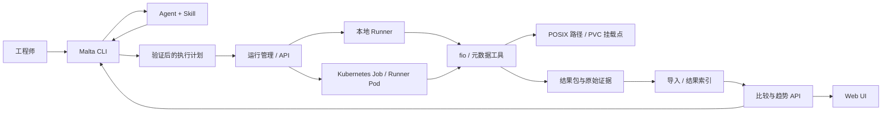

# Malta

**Agent 增强与管理的分布式文件系统性能对照平台。**

Malta is an agent-enhanced platform for orchestrating, managing, and comparing distributed file system benchmarks. It combines a scriptable CLI, reproducible data and metadata baselines, and a visual workspace to compare performance across versions, dates, and hardware environments, with planned Kubernetes execution and evidence-based agent analysis.

Malta（马耳他）以可重复的测量为基础，让工程师与 Agent 共用一套 CLI、测试定义和结果契约，完成“制定计划 → 执行测试 → 管理运行 → 对照基线 → 分析证据”。项目名称取自地中海岛国马耳他。

> **状态：设计阶段。** 当前包含 README、架构与测试方法文档，以及 skill、Kubernetes 和镜像构建的目录说明。UI 为交互草图；CLI、API、压测执行器、可安装 skill 与部署清单均未实现。下文命令和目录树描述目标设计。

## 平台定位

Malta 管理性能实验及其证据，回答以下问题：

- 相同环境下，不同版本和日期的数据、元数据性能有何变化？
- 不同文件大小、I/O 块大小、读写方式和并发下，吞吐、IOPS、尾延迟如何变化？
- 同一版本在不同云环境、实例类型或物理机上的表现如何？
- 在指定延迟与错误率约束下，当前测试范围内的最佳性能是多少？
- Agent 能否自动选择负载、跟踪运行，并依据原始结果解释差异、提出下一轮验证方案？

平台由三类入口组成：**CLI 负责执行与管理，UI 负责浏览与对照，Agent 通过 skill 调用相同能力**。Agent 从首版接口设计开始参与，自动分析能力逐步完善。

## 性能基线与管理维度

### 数据性能

覆盖顺序读、顺序写、随机读、随机写、混合读写。文件大小与 I/O 块大小独立建模，例如“1 GiB 文件上的 4 KiB 随机读”不同于“4 KiB 小文件读取”。

负载定义记录单文件大小、文件数、总工作集、块大小、读写比例、文件共享方式、进程数、队列深度、I/O 引擎、预热与测量时长。记录 buffered/direct I/O、缓存状态、同步与持久化语义，混合负载分别报告读写指标。

### 元数据性能

将 create、stat、unlink、mkdir、rmdir、rename、readdir 等操作作为独立基线，记录对象总量、每目录条目数、目录深度、共享目录争用和并发数。以 ops/s 及工具实际提供的延迟指标展示；没有采集的操作和分位数明确标记缺失。

首版设计同时覆盖数据与元数据的结果模型和 UI。执行适配先落地 fio；元数据从经验证的结果导入开始，再逐步接入 mdtest 及其他工具，不假定一个工具支持全部操作。

### 版本与硬件环境

| 维度 | 管理内容 |
| --- | --- |
| 软件版本 | 文件系统名称、release/tag、commit、构建或镜像 digest、客户端与服务端版本 |
| 云环境 | 云厂商、region/AZ、实例类型、CPU 架构、云盘类型及容量/性能配置、网络限制 |
| 物理机 | 厂商与机型、CPU、内存、磁盘、网卡、机房与拓扑 |
| 配置快照 | 客户端、数据/元数据服务端各自的机型与节点数，挂载参数、副本与缓存配置 |
| Kubernetes | cluster、namespace、Pod/Job UID、节点、资源 requests/limits、PVC/StorageClass、CSI 驱动及版本 |
| 运行身份 | run_id、attempt_id、UTC 时间、工具与 Malta 版本、调用来源及计划摘要 |

每套基线绑定 **版本 × 环境快照 × 负载定义**，并指向确定的 Run/Trial。硬件或拓扑变更产生新快照。跨版本对比固定环境与负载；跨硬件对比明确标记为硬件实验，不能将其差异直接归因于版本。

## 技术方案

| 层次 | 选型 | 职责 |
| --- | --- | --- |
| CLI、API、Runner、比较逻辑 | Go | 统一执行入口、生命周期管理、结果解析与服务端判断 |
| UI | TypeScript + React + Vite | 版本、环境、负载筛选及交互对比 |
| 图表 | Apache ECharts | 历史趋势、并发曲线、延迟分布 |
| 测试引擎 | fio；逐步接入 IOR / mdtest 等 | 生成负载，Malta 负责组织与标准化 |
| 摘要与索引 | SQLite；按需扩展 PostgreSQL | 单服务实例起步，避免提前引入复杂依赖 |
| 原始证据 | 本地 artifact 目录；逐步扩展对象存储 | 保存配置、输出、日志与校验和 |
| 接口契约 | JSON Schema + OpenAPI | CLI、UI、Agent 共用稳定的数据语义 |
| 集群执行 | Kubernetes Job + 已有 PVC/CSI | Pod 内运行测试，记录调度与挂载条件 |

Go 服务计划嵌入构建后的前端资源。Runner 镜像包含固定版本的测试工具；模型服务、Agent 运行时和 Node.js 不作为压测进程的运行依赖。Python 可用于独立分析实验。

## 架构与执行流程



采用单仓库、模块化单体。共享服务管理 Run 和状态，执行后端分为 local 与 kubernetes。`local` 指服务所在测试节点，不隐式代表远程 CLI 所在机器。离线执行另提供前台 `exec` 入口，输出可移植结果包后再导入。

## CLI：人和 Agent 共用的操作入口

以下为接口草案，尚不能执行。

| 命令组 | 预期功能 |
| --- | --- |
| `malta plan` | 校验负载、目标与环境，展开参数矩阵，生成不可变执行计划；不发起 I/O |
| `malta run start` | 提交计划，返回 run_id；支持 local/kubernetes executor 与幂等 request-id |
| `malta run list/get` | 查询任务、attempt、状态、错误和结果引用 |
| `malta run logs/wait` | 获取日志、等待终态；等待超时不意味着测试已取消 |
| `malta run cancel` | 请求停止任务并清理测试进程，保留结果与证据 |
| `malta exec` | 在当前机器或 Pod 前台执行已验证计划，写出结果包 |
| `malta result import/export` | 校验、导入或导出结果包，重复导入保持幂等 |
| `malta baseline list/set` | 查询或创建基线版本，保留旧引用 |
| `malta compare` | 对比指定基线与候选，返回可比性、差异与证据 |
| `malta environment register/list/show` | 登记或查看云、物理机、集群及配置快照 |
| `malta version register/list/show` | 登记或查看 release、commit、构建与版本身份 |
| `malta serve` | 启动运行管理、API 与 UI |

```sh
# 接口草案：文件名与 ID 为占位，相关模板尚未实现
malta plan --spec benchmarks/data/seq-read.yaml --environment environments/cloud/example.yaml --target /bench/malta --output plan.json --format json --non-interactive
malta run start --plan plan.json --executor kubernetes --server http://127.0.0.1:8080 --request-id experiment-001 --format json --non-interactive
malta run get RUN_ID --server http://127.0.0.1:8080 --format json
malta run wait RUN_ID --server http://127.0.0.1:8080 --timeout 30m --format json
malta run cancel RUN_ID --server http://127.0.0.1:8080 --format json --non-interactive
malta compare --baseline BASELINE_ID --candidate RUN_ID --server http://127.0.0.1:8080 --format json

# Pod 内或本地离线执行：前台运行，无需运行管理服务
malta exec --plan /etc/malta/plan.json --output /results --format json --non-interactive
```

自动化契约：

- `--format json` 输出版本化结构；stdout 仅包含机器可读结果，诊断信息写 stderr。流式日志单独定义 NDJSON 格式。
- `--non-interactive` 不弹交互提示；缺少必需配置时返回结构化错误。计划固定目标路径、资源、时长与数据规模，提交时重新验证环境和挂载。
- 同一 request-id 与相同计划返回同一逻辑运行；同一 ID 对应不同计划返回冲突。创建和结果导入的幂等性不代表底层 I/O 恰好执行一次。
- 固定退出码区分参数/契约错误、执行失败、等待超时和取消；比较发现性能差异与 CLI 自身出错分别表达。
- 后台生命周期由服务或 Kubernetes 管理，不依赖 Agent 的会话存活。运行状态与结果导入状态分开记录，测试成功不代表证据已经持久保存。

## Agent skills

[`skills/`](skills/README.md) 保存项目随仓库版本发布的 Agent 操作说明，规划 `malta-benchmark`、`malta-analysis` 两类 skill。当前只预留目录与约定；待 CLI 契约实现后添加可安装的 `SKILL.md`、参考资料和可验证示例。

测试 skill 指导 Agent 读取需求、选择模板和环境、生成计划、发起测试、查询/取消、收集结果与建立对照。分析 skill 负责解释变化、引用具体运行与指标、提出后续实验。

Agent 在已配置的测试环境、资源额度和目标目录内执行，记录调用来源、request-id、计划与运行引用。用户已经授权的测试范围内无需反复交互确认；超出范围返回明确错误。基线晋升遵循项目显式策略，不能用一次异常运行覆盖历史基线。分析报告与原始测量分开存储，区分事实、推断和建议。

Skill 调用标准 CLI，不另建一套测试逻辑，也不绑定特定模型供应商。

## Kubernetes 执行与挂载

[`deploy/kubernetes/`](deploy/kubernetes/README.md) 预留运行管理服务、Runner Job、RBAC 与环境 overlays；[`build/docker/`](build/docker/README.md) 预留 server/runner 镜像构建。

- **服务**：Deployment + Service 提供运行管理、API 和 UI。首版 SQLite 单副本，数据库使用独立、支持其锁语义的本地或块存储文件系统，不能放到被测分布式文件系统上。
- **测试**：Job 创建 Runner Pod，复用已有 PVC 和 CSI 挂载，在独立测试子目录中执行。文件系统部署、CSI 安装和 PVC 准备由环境配置负责。
- **挂载**：`/bench` 为被测卷，`/etc/malta` 为只读计划，`/results` 为独立结果卷或上传暂存区。结果不得只依赖 Pod 可消失的临时盘。
- **调度**：配置 namespace、节点选择、亲和性、资源 requests/limits 和 deadline，记录实际节点、镜像 digest、挂载与资源限制。执行前检查 PVC 访问模式和拓扑能否满足目标 Pod 数。
- **权限**：提交端与执行 Pod 分离身份。提交端使用目标 namespace 的必要权限；仅操作挂载目录的 Pod 不自动获得 Kubernetes API 权限，也不默认使用 privileged 或 hostPath。
- **重试**：起步采用 `restartPolicy: Never`、`backoffLimit: 0`，运行管理仍须处理重复启动、Pod 丢失和超时；每个 attempt 使用独立目录和身份，资源组协调避免重叠压测，不能把 Job 当作恰好一次执行保证。
- **结果**：确认结果持久化/上传完成后再安排 TTL 清理；失败保留诊断。重复 attempt 不算独立的计划内重复实验。

第一步支持单 Job / 单测试客户端；多 Pod 同步、多客户端时间对齐和全局聚合独立验收。参考 Kubernetes [Job](https://kubernetes.io/docs/concepts/workloads/controllers/job/)、[PV/PVC](https://kubernetes.io/docs/concepts/storage/persistent-volumes/) 与 [ServiceAccount](https://kubernetes.io/docs/tasks/configure-pod-container/configure-service-account/) 文档。

## UI 设计

视觉参考 [JuiceFS 官网](https://cf.juicefs.com/zh-cn/) 的绿色、留白与圆角元素。当前确认的样式为纯白底，浅绿与薄荷绿点缀，辅以轻微网格和细线条。采用适合高密度数据阅读的表格和清晰层级，不复用其品牌图形。

| 入口 | 主要内容 |
| --- | --- |
| 性能基线 | 文件 I/O / 元数据切换；文件大小、块大小、读写类型、版本与环境筛选；候选与基线并排 |
| 版本管理 | release/commit/build、测试覆盖与各环境的基线入口 |
| 硬件环境 | 云厂商 + 实例类型、物理机型号、客户端/服务端拓扑与不可变快照 |
| 测试运行 | 来源（人工/Agent）、执行后端、Run/attempt 状态、日志、计划与结果证据 |
| 对照与趋势 | 历史日期、版本变化、并发扫描及约束内最佳点；先展示可比性 |

现有交互草图覆盖前三个入口，后两个入口为后续实现目标。Agent 发起的测试出现在相同运行列表中，分析报告挂在对应运行或对照记录下。

## 测量与比较原则

原始输出、负载定义、环境快照、执行参数和 artifact 哈希必须留存。同一参数点规划独立重复至少 3 次，展示中位数及波动；不完整与失败结果不能补成零值。

吞吐区分 MB/s 与 MiB/s，读写分别统计，延迟区分 slat/clat/lat；分位数不能直接求平均当作全局分位数。元数据未报告的延迟保留缺失值。可比性检查区分允许的实验变量与未控制差异。

性能极限是特定环境、负载、扫描范围与延迟/错误率约束下的观测结果。单客户端结果不能代表整个集群。详见 [测试方法](docs/benchmark-methodology.md)。

## 目录规划

当前实际存在 `README.md`、`docs/`、`skills/README.md`、`deploy/kubernetes/README.md` 和 `build/docker/README.md`。其余路径为目标结构，随功能实现创建。

```text
malta/
├── cmd/malta/                     # 面向人和 Agent 的 CLI 入口
├── internal/
│   ├── domain/                    # Plan、Run、Attempt、环境与指标
│   ├── cli/                       # 命令、JSON 输出与退出码
│   ├── runner/                    # 前台执行与子进程生命周期
│   ├── executor/{local,kubernetes}/ # 后端提交、状态、取消与回收
│   ├── engine/{fio,metadata}/     # 工具参数、能力与输出适配
│   ├── compare/                   # 可比性、基线匹配和统计
│   ├── store/                     # 索引、运行状态与 migrations
│   ├── artifact/                  # 结果包、文件哈希与导入
│   └── api/                       # 共用运行管理与查询服务
├── web/                           # React UI 与静态资源嵌入
├── api/openapi.yaml                # 版本化 HTTP API
├── schemas/                       # 计划、结果包、CLI 输出契约
├── benchmarks/{data,metadata}/     # 负载模板
├── environments/{cloud,bare-metal,kubernetes}/ # 不含凭证的环境模板
├── skills/
│   ├── README.md                  # skill 约定与实现状态
│   ├── malta-benchmark/SKILL.md    # 规划：执行与管理测试
│   └── malta-analysis/SKILL.md     # 规划：对照与证据分析
├── deploy/kubernetes/
│   ├── README.md                  # 挂载与执行设计
│   ├── base/                      # 规划：服务、身份与基础配置
│   ├── jobs/                      # 规划：Runner Job 模板
│   └── overlays/                  # 规划：环境差异与部署参数
├── build/docker/                  # 镜像构建说明；后续 server/runner Dockerfile
├── testdata/                      # 脱敏工具输出与预期
├── tests/{integration,e2e}/        # CLI、API、UI、集群执行闭环
├── docs/                          # 架构与测试方法
├── scripts/                       # 构建和开发辅助
└── go.mod                         # Go 依赖
```

## 实现路线

| 阶段 | 交付内容 | 验收标准 |
| --- | --- | --- |
| M0：契约 | Plan/Run/Attempt、CLI JSON、环境快照、数据/元数据结果 schema | Agent 可按 schema 生成计划；fixture 解析与可比性规则明确 |
| M1：CLI 与执行 | local 执行、服务管理、fio、结果包、Agent 测试 skill | 非交互发起/查询/等待/取消；幂等提交；中断与失败可追溯 |
| M2：平台 MVP | 基线 UI、版本/环境管理、基本元数据导入、单 Job PVC 挂载与镜像 | 同环境两批结果可对比；Pod 退出后证据仍可查询；Agent 可完成一次测试闭环 |
| M3：集群测试 | 多客户端协调、IOR/mdtest 等适配、资源观测 | 验证同步窗口、聚合与资源隔离，区分客户端和服务端瓶颈 |
| M4：分析增强 | Agent 分析 skill、报告、后续实验建议 | 结论能引用原始证据，建议可转为受约束的下一轮计划 |

首版完成边界为 M0–M2。Agent 操作契约、CLI 与 Kubernetes 单 Pod 路径进入首版范围；高级诊断和多客户端扩展逐步推进。

具体编码顺序、目录职责、逐阶段验收和发布标准见 [v0.1 代码实现路线图](docs/roadmap-v0.1.md)。

## 设计文档

- [v0.1 代码实现路线图](docs/roadmap-v0.1.md)
- [架构与语言选型](docs/architecture.md)
- [Benchmark 方法与比较规则](docs/benchmark-methodology.md)
- [Agent skills 规划](skills/README.md)
- [Kubernetes 部署与运行规划](deploy/kubernetes/README.md)
- [容器镜像规划](build/docker/README.md)

依赖版本、安装教程、可执行示例、支持的 Kubernetes/CSI 组合将在实现与验证后补齐。许可证尚未选定。
