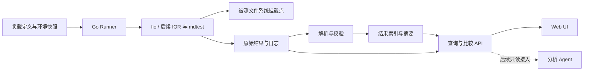

# Malta

Malta is a benchmarking and visualization platform for distributed file systems, designed to establish reproducible performance baselines and compare performance limits across dates, versions, and configurations through an intuitive web UI. Future plans include agent-assisted analysis and bottleneck diagnosis.

Malta（马耳他）致力于让分布式文件系统的性能测试可重复、可追溯、可比较。项目名称取自地中海岛国马耳他。

> **项目状态：设计阶段。** 当前仓库包含项目说明与架构规划，尚无可运行的 CLI、服务或 UI。下文中的能力、目录和命令均为实现目标。

## 要解决的问题

性能测试不应只有一张截图或一个最大吞吐数字。Malta 希望回答：

- 相同测试条件下，新版本相较基线有多少提升或回退？
- 随客户端并发增加，吞吐量、IOPS 和尾延迟如何变化？
- 在约定的延迟和错误率约束下，当前配置能达到怎样的性能上限？
- 某一天的异常来自版本、环境、缓存还是负载变化？有哪些证据可以复查？

“性能上限”指指定环境、负载和测试范围内观测到的上限。单客户端结果不能直接代表整个分布式集群的极限。

## 核心能力规划

| 能力 | 内容 | 阶段 |
| --- | --- | --- |
| 可重复测试 | 声明式负载、环境快照、工具版本、原始结果留存 | MVP |
| 基线管理 | 选定不可变的测试结果作为基线，按负载和环境匹配 | MVP |
| 历史与版本对比 | 按测试日期、文件系统版本、配置筛选，展示差异及波动 | MVP |
| 并发阶梯测试 | 扫描进程数和队列深度，绘制吞吐与延迟曲线 | MVP：单客户端 |
| 多客户端测试 | 协调启动、采集各客户端结果，分析集群扩展性 | 后续 |
| 元数据性能 | 创建、查询、删除等操作的性能测试 | 后续 |
| Agent 分析 | 基于结构化结果与原始证据解释回退、提出验证建议 | 后续 |

首版面向 **Linux 客户端上已挂载的 POSIX 文件系统路径**，由使用者完成文件系统部署和挂载。Curvine、JuiceFS 等可作为候选测试对象，实际支持范围以客户端接口及测试验证为准；HDFS、S3 等其他访问接口需要独立适配。

## 技术方案

| 层次 | 建议选型 | 选择理由 |
| --- | --- | --- |
| CLI、Runner、HTTP API、比较逻辑 | Go | 统一实现进程控制、结果解析与服务端逻辑，便于在 Linux 测试节点部署 |
| Web UI | TypeScript + React + Vite | 适合实现筛选、交互图表和多运行对比，静态构建产物可随服务发布 |
| 图表 | Apache ECharts | 用于历史趋势、并发曲线、延迟分布及热力图 |
| 测试引擎 | fio；后续接入 IOR / mdtest | 复用成熟工具，Malta 负责测试组织、数据规范和分析 |
| 元数据与摘要 | SQLite，后续按需引入 PostgreSQL | MVP 使用单服务实例，降低部署复杂度；多服务实例再迁移 |
| 原始结果与日志 | 本地 artifact 目录，后续支持对象存储 | 保留可复查证据，避免大文件直接进入关系数据库 |
| 数据契约 | JSON Schema + OpenAPI | 规范结果格式与 API，供 UI 和后续 Agent 共用 |

首版只引入 **Go 和 TypeScript 两种主要开发语言**。Python 可用于后续独立分析实验，但不作为服务运行的必需依赖。Rust/C++ 仅在确实需要自研压测引擎时重新评估。

Malta 的 Go 进程负责调度外部工具，不参与逐次文件 I/O；基准结果仍需验证工具本身及采集行为的开销。语言取舍与模块边界见 [架构设计](docs/architecture.md)。

## 整体流程



MVP 采用单仓库、模块化单体：一个 `malta` 可执行文件提供测试、导入和服务入口。测试数据路径与 Malta 的数据库、日志路径分离。生产发布计划嵌入前端静态资源，运行时无需 Node.js；fio 等测试工具仍需单独安装。

## Benchmark 设计

首批负载覆盖大块顺序读写、小块随机读写及固定比例混合读写。每种负载固定数据集、块大小、I/O 引擎、缓存策略和持久化语义，再扫描进程数或队列深度。

每份结果至少记录：

- **身份**：运行 ID、UTC 时间、文件系统版本/commit、Malta 与测试工具版本。
- **环境**：客户端与服务端配置、CPU/内存、磁盘、网络、节点数量、挂载参数。
- **负载**：读写模式、块大小、文件布局、数据量、并发、队列深度、预热与测量时长、随机种子。
- **语义**：缓存状态、buffered/direct I/O、同步策略、压缩与去重相关的数据生成方式。
- **结果**：读写分别统计的吞吐量、IOPS、延迟类型及分位数、错误、实际测量时长和重复实验结果。
- **证据**：解析前的工具输出、执行参数、日志、配置摘要与 artifact 校验和。

同一负载点建议独立重复至少 3 次，保留全部结果，展示中位数及离散程度；具体次数和时长由测试方案确定。失败或不完整的测试不能作为零值计入基线，缺失指标显示为缺失。

版本对比允许版本变化，但必须检查其他条件。环境信息不完整或存在未控制差异时，应展示差异并标记可比性不足。延迟分位数不能直接求平均充当聚合分位数。详细规则见 [测试方法](docs/benchmark-methodology.md)。

## UI 规划

| 页面 | 主要内容 |
| --- | --- |
| Runs | 按日期、文件系统、版本、负载、环境与状态查找测试 |
| Run detail | 配置与环境、重复实验分布、指标摘要、原始结果和错误信息 |
| Compare | 选择基线与候选，先查看可比性和配置差异，再看性能差异 |
| Trends & limits | 同条件历史趋势、并发—吞吐/IOPS 曲线、并发—P99 曲线及约束内最佳点 |

图表和表格共享同一套服务端比较结果。时间统一存为 UTC，界面明确显示展示时区；吞吐单位区分 MB/s 与 MiB/s。单次异常不自动标为确定的性能回退。

## 目录规划

以下为目标结构；当前仅存在 README 与 `docs/` 下的设计文档，代码目录随对应功能实现创建。

```text
malta/
├── cmd/malta/                  # CLI 入口
├── internal/
│   ├── domain/                 # Run、负载、环境、指标等领域类型
│   ├── runner/                 # 执行生命周期、超时、取消与结果收集
│   ├── engine/fio/             # 参数生成、能力检查和输出解析
│   ├── compare/                # 可比性检查、基线匹配与统计
│   ├── store/                  # SQLite 查询、事务与 SQL migrations
│   ├── artifact/               # 原始文件与校验和
│   └── api/                    # HTTP 接口
├── web/
│   ├── src/                    # 页面、图表、API 客户端
│   └── embed.go                # 嵌入构建后的静态资源
├── api/openapi.yaml            # HTTP API 契约
├── schemas/                    # 测试定义与结果的版本化 JSON Schema
├── benchmarks/                 # 版本化负载模板，不存真实运行结果
├── testdata/                   # 小型脱敏工具输出和解析预期
├── tests/integration/          # 最小执行—导入—对比闭环验证
├── docs/                       # 架构、方法与后续使用文档
├── scripts/                    # 构建和开发辅助脚本
└── go.mod                      # Go 模块与依赖
```

## 实现路线

| 阶段 | 交付内容 | 验收标准 |
| --- | --- | --- |
| M0：数据契约 | Run/result schema、fio 输出样例、单位和可比性规则 | 正确解析代表性输出；缺失、错误、不同单位有明确处理 |
| M1：执行闭环 | 本地 Runner、fio、结果包、SQLite、导入和查询 | Linux 挂载路径完成一次最小测试；重复导入不重复计数；失败可追溯 |
| M2：可视化 MVP | 四类页面、基线比较、历史趋势、单客户端并发扫描 | 两批真实测试可对比、可下载证据；环境差异与波动可见 |
| M3：集群能力 | 多客户端协调、IOR/mdtest、可选监控对接 | 验证时间窗口和聚合规则；识别客户端与服务端瓶颈 |
| M4：Agent | 只读查询接口、分析报告及证据引用 | 报告能回溯具体运行和指标，并区分观测、假设与建议 |

首版完成边界为 M0–M2。M3/M4 不阻塞首版交付。初期不建设通用工作流平台、自动部署文件系统或多租户服务。

## 使用入口草案

**以下命令尚未实现，用于明确预期交互，不是当前可执行的安装或使用教程。**

```sh
malta run --spec benchmarks/seq-read.yaml --target /mnt/fs/malta-test --output ./results
malta import ./results/<run-id> --data-dir ./malta-data
malta serve --data-dir ./malta-data --listen 127.0.0.1:8080
```

`run` 产生独立结果包，`import` 将其加入服务的数据目录，`serve` 提供 API 和 UI。已有 fio 结果需要补充负载与环境 manifest 后才能参与可靠比较。构建、安装和部署教程将在实现对应功能后补齐。

## 设计文档

- [架构与语言选型](docs/architecture.md)
- [Benchmark 方法与比较规则](docs/benchmark-methodology.md)

开发依赖版本将在首次代码实现时通过 `go.mod` 与前端 lockfile 固定。项目许可证尚未选定。
