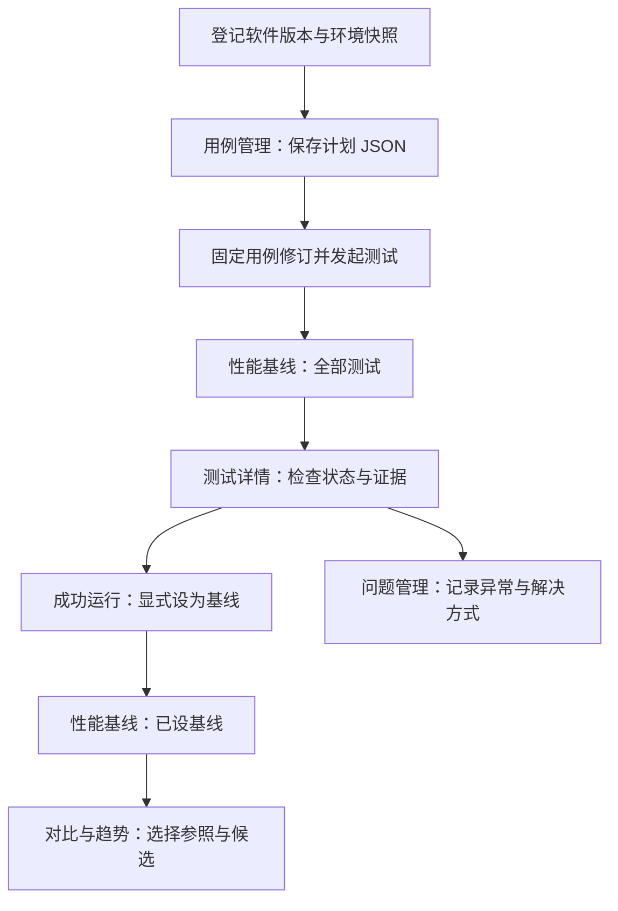

# Malta

**Agent 增强与管理的分布式文件系统性能对照平台。**

Malta is an agent-enhanced platform for orchestrating, managing, and comparing distributed file system benchmarks. It combines a scriptable CLI, reproducible data and metadata baselines, and a visual workspace to compare performance across versions, dates, and hardware environments.

Malta（马耳他）以可重复的测量为基础，让工程师与 Agent 共用一套 CLI、测试定义和结果契约，完成“保存用例 → 执行测试 → 固定基线 → 对比版本 → 追踪问题”。前端以简洁卡片呈现摘要，通过独立详情查看配置和证据；Agent 通过 CLI/API 操作相同的数据。名称取自地中海岛国马耳他。

> **当前范围：S0–S7 代码已实现，进入 v0.1 RC 验证。** 本地与 Kubernetes Job 执行、CLI/API、结果存储、基线比较及 React UI 已接通。服务 Pod 与测试 Pod 独立，通过结果 PVC 回传证据。Agent 能力发现、会话恢复和 skill 已补齐；提供可复现构建、安装升级文档与 Apache-2.0 许可证。生产 CSI、固定实验室性能与外部模型行为仍需专项验收。

## 已实现的能力

| 部分 | 当前实现 |
| --- | --- |
| 文件 I/O | fio 3.33；顺序读写、随机读写、混合读写；文件大小与块大小独立；jobs/depth 矩阵与重复实验 |
| 元数据 | mdtest 4.0.0 文件模式导入；原生 stat 与 create/write/fsync/stat/read/unlink 生命周期；按引擎区分延迟口径 |
| 用例管理 | 保存完整计划 JSON、名称与描述；不可变版本历史、编辑生成新版本、固定版本发起测试，支持 UI / CLI / API |
| 问题管理 | 用户/Agent JSON 上传；自定义类型、软件/硬件/运行关联、解决状态与方式、不可变修改历史 |
| 混合场景 | 顺序/并行 fio、按操作数加权的数据与 stat、逐文件流水线；独立指标、实际配比和时间线 |
| 环境 | 硬件卡片按云类型、角色数量与机型归组；不可变执行快照保留区域、CPU/内存/存储/网络、运行身份与配置 |
| 版本 | 文件系统、版本标签、commit、构建或镜像身份；相同 ID 不可覆盖 |
| CLI 与 API | 计划、前台执行、托管运行、查询/等待/取消/日志、导入导出、登记、基线与比较 |
| 基线 | 显式固定成功运行；逐项检查可比性；重复中位数、Min/Max、变化率、零基线与缺失值处理 |
| Web UI | 浅色与深色主题、绿色强调；卡片摘要 → 独立详情 → 折叠技术信息；统一基线与全部测试入口，支持数据/元数据/混合场景、对比趋势与证据下载 |
| Agent | JSON envelope、能力发现、退出码、request-id 查询与会话恢复、本地/Kubernetes skill；与人工共用业务规则 |

“最高已测性能”是指定矩阵和测量窗口内的结果，不代表绝对系统极限。跨硬件实验会显示条件差异，不能直接归因于版本回归。P99 展示为各次实验 P99 的中位数，不冒充合并分布的 P99。

## 前端 UI 设计

界面采用固定侧栏与内容工作区：侧栏负责模块切换，内容区依次展示页面标题、主要操作、筛选条件和卡片。列表突出用户需要识别与比较的信息；打开详情后再查看完整参数、历史记录和操作入口，原始 JSON、镜像摘要等放入默认折叠的技术信息区域。

### 页面与信息层级

| 侧栏模块 | 列表 / 摘要 | 详情与主要操作 |
| --- | --- | --- |
| 性能基线 | **已设基线 / 全部测试**两个页签；卡片显示名称、软件版本、负载、云环境、状态、日期与主要指标 | 发起测试；查看负载和重复实验指标、已测并发曲线；取消任务、设为基线、下载证据、进入对比 |
| 问题管理 | 标题、自定义类型、解决状态、软件与发现时间 | 查看问题描述、关联环境/运行、修改历史和解决方式；导入 JSON、编辑与跟进 |
| 用例管理 | 名称、负载类型、修订号、简述与更新时间 | 查看可读负载参数、切换历史修订、编辑为新版本、导出 JSON、使用指定版本测试 |
| 软件版本 | 文件系统与版本名称 | 查看构建身份及该版本关联测试 |
| 硬件环境 | **云类型 + 客户端/服务端数量 + 机器型号** | 硬件配置、测试配置、关联测试三个页签；选择执行快照，查看区域、挂载、UID/GID、资源额度与镜像等细节 |
| 对比与趋势 | 两个测试摘要、可比性结论与关键指标变化 | 选择参照与候选测试，查看条件差异、完整指标及日期趋势 |
| 使用指南 | JSON 填写、测试执行与结果比较的任务导航 | 阅读字段说明，展开、复制或下载普通与混合负载示例 |

**“测试运行”不再作为独立侧栏页面。** 所有状态的测试统一进入「性能基线 → 全部测试」；「已设基线」仅展示人工或 Agent 显式命名的成功运行，成功完成测试不会自动成为基线。旧 `?page=runs` 链接仍可用，会转入「全部测试」。

硬件卡片示例（仅展示格式）：

```text
阿里云
测试客户端             1 台 × ecs.g8i.2xlarge
服务端 / Worker（共置） 3 台 × ecs.g8i.2xlarge
                                      查看详情 →
```

同类硬件下的身份、配额或镜像变化保存在不同执行快照中，不会重复生成硬件卡片；机器数量或型号变化则分为不同类别。硬件归组用于浏览，**不放宽测试可比性规则**，比较时仍核对具体执行快照和负载条件。

### 从用例到性能对照



软件升级后先登记新版本及实际环境快照，再把原用例编辑为新修订并执行。进入「全部测试」查看新结果，从详情进入对比，选择旧结果作为参照；先确认条件是否可比，再解读指标变化。卡片中不展开长 JSON，用例的原始定义、测试证据和不可变历史仍可在详情获取。

### 视觉与交互约定

采用留白、细边框和低饱和绿色强调，避免用大量颜色承载技术信息。提供右上角主题切换；默认深色，浅色适合明亮环境，主题选择保存在浏览器本地。

| 视觉元素 | 浅色主题 | 深色主题 |
| --- | --- | --- |
| 页面底色 | 灰白 `#f7f8f5` | 炭黑 `#161616` |
| 卡片底色 | 白色 `#ffffff` | 深灰 `#1c1c1c` |
| 强调色 | 深绿 `#4a692e`，浅绿底 `#e8efdc` | 浅绿 `#b5d884`，暗绿底 `#263022` |
| 信息表达 | 状态文字配合徽标，指标保留单位，缺失值明确标示 | 与浅色主题使用相同的信息与交互结构 |

卡片随可用宽度换列；正文使用无衬线字体，JSON 使用等宽字体。详情支持直接链接和浏览器前进/后退，打开详情与返回列表保留当前筛选。性能基线支持数据 I/O、元数据与混合场景分类，以及版本、执行快照、日期等条件；UI 列表遵循最多 500 条的加载范围。

前端使用 **React + TypeScript + ECharts**，由 Vite 构建，资源嵌入 Go 二进制。公共卡片、可读字段和折叠技术信息分别由 `RecordCard`、`Facts`、`TechnicalInfo` 组织，主题颜色集中在 CSS 变量中。扩展页面时沿用这套信息层级；提交、取消、基线设置与可比性校验仍由服务端统一处理，UI 与 Agent 共用业务规则。

详细约定见 [工作空间信息组织](docs/workspace-ui.md)与[硬件分类及执行快照](docs/hardware-environments.md)。

## 快速启动

构建需要 **Go 1.26.5、Node.js 24、pnpm 11.25.0**。执行数据测试使用 Linux 和 **fio 3.33**；mdtest 导入不要求服务节点安装 mdtest。首批工具版本依据真实 fixture 固定，其他版本会明确拒绝。

```sh
pnpm --dir web install --frozen-lockfile
pnpm --dir web build
go build -trimpath -o bin/malta ./cmd/malta
mkdir -p /tmp/malta-data
bin/malta serve --listen 127.0.0.1:8080 --data-dir .malta \
  --allow-target /tmp/malta-data --fio /path/to/fio
```

打开 `http://127.0.0.1:8080`。前端静态资源嵌入同一个二进制，生产运行不需要 Node.js。左侧「使用指南」提供 JSON 字段说明、可复制/下载的普通与混合负载计划，以及用例保存、测试发起和结果对比步骤。只构建 Go 而未构建前端时，API/CLI 可用，UI 会提示补建资源。

在另一个终端提交一个小型功能测试：

```sh
bin/malta plan --spec benchmarks/data/smoke-read.yaml \
  --environment environments/local.yaml --version environments/version-example.yaml \
  --target /tmp/malta-data --resource-group local-device --out /tmp/malta-plan.json
bin/malta --server http://127.0.0.1:8080 run start \
  --plan /tmp/malta-plan.json --request-id smoke-001 --source human
bin/malta --server http://127.0.0.1:8080 run wait RUN_ID --timeout 2m
bin/malta --server http://127.0.0.1:8080 baseline set --name initial --run RUN_ID
bin/malta --server http://127.0.0.1:8080 compare --baseline RUN_ID --candidate OTHER_RUN_ID
```

示例环境含 `unknown`，仅用于功能验证。正式基线请填写实际硬件/系统/挂载配置，并使用独立环境 ID。硬件页面按云类型、角色数量和机型归组；UID/GID、额度、镜像等保留在组内执行快照，详见[硬件分类与执行快照](docs/hardware-environments.md)。`benchmarks/data/lab-randread.yaml` 是更大的扫描模板，执行前明确容量与资源预算。

服务默认监听 loopback。设置 `MALTA_TOKEN` 后 API 使用 Bearer 认证；绑定非 loopback 必须配置 Token，远程使用另配 TLS 代理或 SSH 隧道。UI 右上角连接设置可输入已有 Token，凭证仅保存在当前浏览器会话。

可在侧栏「用例管理」保存和编辑测试 JSON，或通过 `malta case` 命令让 Agent 管理用例。编辑生成新版本，执行时固定版本号。见 [用例管理指南](docs/case-management.md)。

可在侧栏「问题管理」登记测试异常，按自定义类型和解决状态筛选，或通过 `malta issue` 供 Agent 上传、查询与跟进。见 [问题管理指南](docs/issue-management.md)。

## 测试与服务隔离

**Server Pod 与测试 Runner Pod 分开部署。** Server 保存 API/UI、SQLite 和证据；测试 Job 挂载被测文件系统，执行压测并回传结果。测试 PVC 与元数据/结果存储分开；关键基线进一步隔离节点、CPU、磁盘与网络资源。

本地和 Kubernetes 后端共用一条保守串行队列。Kubernetes 使用独立 Runner Job、已有测试 PVC 与独立 RWX 结果 PVC，支持取消与重启接管。部署方法见 [Kubernetes 指南](deploy/kubernetes/README.md)。详见 [架构决策 ADR-0001](docs/adr/0001-server-runner-separation.md)。

服务重启将未完成的本地任务标记为 `interrupted`；Kubernetes 任务接管原 Job/Attempt，不重放压测。客户端等待超时不取消任务；重试提交必须复用原 request-id。只有 `attempt.result_state=complete` 才表示证据持久化完成。被测数据保留在独立 run/attempt 子目录，具体位置记录于 `data-paths.json`，由操作者检查后清理。

## 项目结构

```text
cmd/malta/                  CLI 入口
internal/
  domain/                   版本化模型、验证与比较统计
  cli/                      人工与 Agent 命令
  engine/fio/               fio 参数、解析与证据核对
  engine/metadata/          mdtest 导入
  runner/                   前台执行、预算、锁、进程组取消
  store/                    SQLite、不可变登记、证据与恢复
  service/                  托管队列和本地执行生命周期
  api/                      HTTP API、认证与输入校验
web/                        React / TypeScript / ECharts 与 Go 静态嵌入
  src/App.tsx               导航、统一测试入口、详情路由与对比
  src/RecordViews.tsx       公共卡片、可读字段和折叠技术信息
  src/RunCatalog.tsx        已设基线 / 全部测试卡片
  src/Cases.tsx             用例与修订管理
  src/Issues.tsx            问题卡片、详情与历史
  src/Versions.tsx          软件版本与关联测试
  src/HardwareEnvironments.tsx 硬件分组、执行快照与关联测试
  src/style.css             深浅主题、布局与响应式样式
  tests/                    前端统计、硬件归组与导航规则测试
api/                        OpenAPI
schemas/                    生成的 JSON Schema
benchmarks/data/            smoke 与 lab 负载
benchmarks/metadata/        元数据导入条件
benchmarks/scenarios/       多负载、权重混合与生命周期示例
environments/              环境与版本示例
config/                    本地配置，仅提交指定示例和说明
  deploy/                  部署与测试集群 kubeconfig
  parameter/               应用与执行器 YAML 参数
  llm/                     未来模型连接与凭证模板
skills/malta-benchmark/     可安装的本地测试管理 skill
deploy/kubernetes/         服务 Deployment、Runner Job 与参数化部署
build/docker/               独立 Server/Runner Dockerfile 与固定校验和
scripts/                    schema 生成与端到端 smoke
testdata/                  真实工具输出 fixture
docs/                      架构、方法、路线图、实现证据
```

## 开发与验证

```sh
go test ./...
go test -race ./...
go vet ./...
pnpm --dir web test
pnpm --dir web build
go run ./scripts/genschema
MALTA_TEST_FIO=/path/to/fio go test ./internal/runner ./internal/api
MALTA_BIN="$PWD/bin/malta" MALTA_TEST_FIO=/path/to/fio \
  bash scripts/smoke.sh /tmp/malta-smoke-new
```

`smoke.sh` 需要 Bash、curl、Python 3 和未占用的本地测试端口（默认 19481，可设 `MALTA_TEST_PORT`）。它启动临时服务，验证幂等、等待超时、真实重复、基线、导出和取消，然后停止服务；保留证据目录。CI 验证构建、race、前端统计与 schema 漂移；真实 fio 测试用环境变量显式启用。

## 文档与后续路线

- [前端工作空间与信息组织](docs/workspace-ui.md)
- [硬件分类与执行快照](docs/hardware-environments.md)
- [用例管理指南](docs/case-management.md)
- [问题管理指南](docs/issue-management.md)
- [本地配置与示例](config/README.md)（真实连接、参数和密钥默认不入 Git）
- [CLI 与运行说明](docs/cli.md)
- [架构与语言选型](docs/architecture.md)
- [测试方法与可比性](docs/benchmark-methodology.md)
- [多负载场景](docs/mixed-workloads.md)（顺序、并行、权重与流水线）
- [S0–S7 路线图](docs/roadmap-v0.1.md)
- [实现与验证记录](docs/implementation.md)
- [Agent 测试 skill](skills/malta-benchmark/SKILL.md)
- [Kubernetes 部署指南](deploy/kubernetes/README.md)

后续优先级：[第三方 Agent 扩展](docs/third-party-agents.md)中的只读分析、服务端权限/预算、MCP 接口与观测关联。当前 UI 历史与趋势窗口最多 500 条；CLI/API 支持历史分页。更多元数据操作、多客户端协调、自动瓶颈归因、对象存储与多租户仍在后续范围。

## RC 安装与发布

[安装、配置和升级](docs/install.md) · [支持矩阵](docs/support-matrix.md) ·
[验证记录](docs/validation-s5-s7.md) · [第三方 Agent 方向](docs/third-party-agents.md)

```sh
python3 scripts/release.py --version 0.1.0-rc.1 --with-kubectl
```

生成 Linux amd64/arm64、macOS arm64 的内嵌 UI 二进制、skill、文档、依赖许可证
和 SHA-256 校验和。脚本只生成本地制品，不自动发布到 GitHub 或镜像仓库。
项目采用 [Apache-2.0](LICENSE)。
